# A22

Custom firmware for the M-VAVE FM-1 that makes it an FM workstation: fourteen synth and drum engines with eight
algorithms and four live knobs each, drawn in colour vector graphics; eight effects; a four-track tape with knob
automation; four projects; a mixer; Riff and Shake sequencers, an arpeggiator, a step sequencer and eight snapshots.

Nearly all of it is synthesised. KIT's 909, CRISP, LOFI and WORLD kits layer in short CC0 drum recordings, SKINS is
made of them ([docs/SAMPLES.md](docs/SAMPLES.md)), and CYCLE plays single cycles of recorded instruments from
Adventure Kid Waveforms, also CC0 ([docs/WAVETABLES.md](docs/WAVETABLES.md)).

A22 is derived from [h1](https://github.com/jakehandy/h1) by Jake Handy and built on fm1-base.

**[Guide and website](https://abektes.github.io/a22/)** · **[Play it in your browser](https://abektes.github.io/a22/sim/)** ·
**[Download](https://github.com/abektes/a22/releases/latest)** · **[☕ Buy me a coffee](https://buymeacoffee.com/abektes)**

<p>
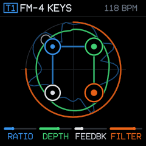 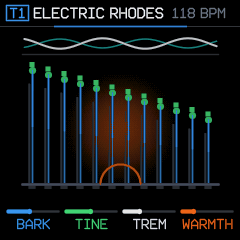 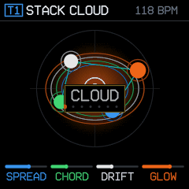 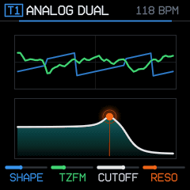 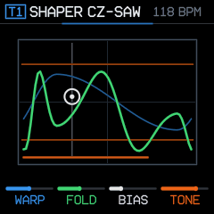
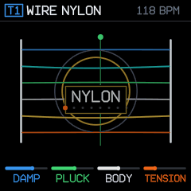 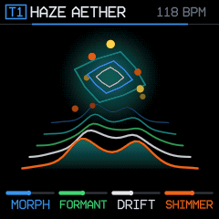 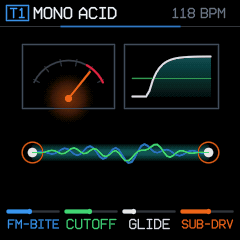 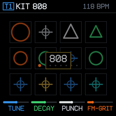 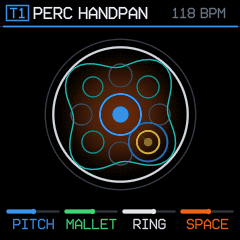
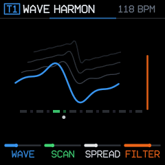 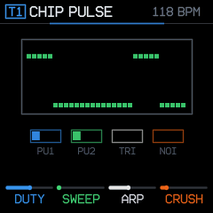 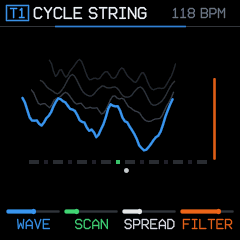 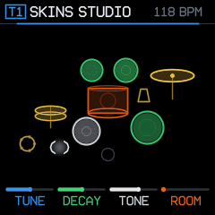
</p>

> **A22 is early.** Every release is installed and run on one FM-1, with every engine, effect and the tape driven
> over USB, but few people have played it at length. Install it only if you are ready to go back to stock or another
> firmware (see [If something goes wrong](#if-something-goes-wrong)).

## Engines

PRESETS picks the engine, ALGORITHM one of its eight algorithms, and the four knobs shape the sound and the picture
together. Each algorithm keeps its own knob settings.

| Engine | Sound | Algorithms | Knobs |
|---|---|---|---|
| **FM-4** | four-operator stereo FM with a filter after it | KEYS, BASS, BELL, PAD, BRASS, PLUCK, ORGAN, ALIEN | RATIO, DEPTH, FEEDBK, FILTER |
| **ELECTRIC** | electric pianos and keys | RHODES, WURLI, DX-EP, CLAV, ORGAN, FELT, VIBES, TAPE | BARK, TINE, TREM, WARMTH |
| **STACK** | stacked chords and wide pads | CLOUD, CHORD, JUNO, GLASS, ORGAN, DRONE, CHOIR, DREAM | SPREAD, CHORD, DRIFT, GLOW |
| **ANALOG** | virtual analog with thru-zero FM and a ladder filter | DUAL, TZFM, SUPER, SUB, SYNC, ACID, BRASS, CHORD | SHAPE, TZFM, CUTOFF, RESO |
| **SHAPER** | phase distortion and wavefolding | CZ-SAW, CZ-RES, BUCHLA, PLUCK, METRIC, CYBER, GLASSY, CRUSH | WARP, FOLD, BIAS, TONE |
| **WIRE** | plucked and bowed strings, physically modelled | NYLON, STEEL, HARP, KOTO, CLAV, BASS, SITAR, BOWED | DAMP, PLUCK, BODY, TENSION |
| **HAZE** | evolving ambient textures | AETHER, VOX, SOLAR, ICE, MIST, ABYSS, PRISM, GHOST | MORPH, FORMANT, DRIFT, SHIMMER |
| **MONO** | monophonic leads and basses, with glide | ACID, REESE, SH-LEAD, ZAP-BASS, GROWL, SUB-808, LASER, HOOVER | FM-BITE, CUTOFF, GLIDE, SUB-DRV |
| **KIT** | drum kits, a drum on every note of the octave | 808, 909, CYCLES, CRISP, LOFI, MODULAR, METAL, WORLD | TUNE, DECAY, PUNCH, FM-GRIT |
| **PERC** | tuned percussion: eight modes a note, sympathetic strings at the top of SPACE | HANDPAN, MARIMBA, KALIMBA, TABLA, WOOD, GAMELAN, STEEL, GLITCH | PITCH, MALLET, RING, SPACE |
| **WAVE** | wavetables: eight banks of fifteen waves, morphing, band-limited per octave | HARMON, ORGAN, VOX, DIGI, PULSE, SYNC, GLASS, GROWL | WAVE, SCAN, SPREAD, FILTER |
| **CHIP** | 8-bit console voices: pulses, stepped triangle, noise, arpeggios | PULSE, TRI, NOISE, ARP, BASS, LEAD, DRUM, DUET | DUTY, SWEEP, ARP, CRUSH |
| **CYCLE** | WAVE's player on single cycles of recorded instruments ([AKWF](docs/WAVETABLES.md)): four banks, each smooth and stepped | STRING, REED, KEYS, VOICE, STEP-STR, STEP-RD, STEP-KEY, STEP-VOX | WAVE, SCAN, SPREAD, FILTER |
| **SKINS** | two recorded drum kits ([Virtuosity Drums and VCSL](docs/SAMPLES.md)), a drum on every note: acoustic, and marching and orchestral, each dry, in a room, tight and vintage | STUDIO, LIVE, TIGHT, VINTAGE, ORCH, HALL, MARCH, SHELLAC | TUNE, DECAY, TONE, ROOM |

## Effects

One effect at a time, chosen on the FX page with ALGORITHM. PLATE, DELAY, SHIFT, CHORUS and TANK are sends, set per
track. FILTER, LOFI and THUMP work on the whole mix.

| Effect | Knobs |
|---|---|
| **PLATE** (plate reverb) | MIX, DECAY, DAMP, MOD |
| **DELAY** (tape ping-pong) | MIX, TIME, FEEDBK, TAPE |
| **FILTER** (resonant filter with an envelope follower) | LPF, HPF, RESO, ENV |
| **SHIFT** (frequency shifter and comb) | FREQ, DELAY, FEEDBK, MIX |
| **CHORUS** | MIX, RATE, DEPTH, WIDTH |
| **TANK** (spring reverb) | MIX, DECAY, TWANG, TONE |
| **LOFI** (lo-fi) | CRUSH, RATE, BAND, GRIT |
| **THUMP** (drive and transient) | PUNCH, DRIVE, BASS, TONE |

The master bus has its own three-band EQ and drive (the MIX page's last subpage).

**PUNCH.** Hold FX and one of the eight white keys from the lowest F to hit the whole mix for as long as the key is
held: 1 BRAKE, 2 ST 1/8, 3 ST 1/16, 4 ST 1/32 (stutters at TEMPO), 5 LPF and 6 HPF (a sweep over a bar), 7 CRUSH,
8 GATE (1/16). Other keys play notes, a second punch key replaces the first, and the key keeps its punch after FX is
let go. A strip at the bottom of the screen shows the eight and lights the one held. FX tapped alone still opens the
FX page, and EDIT + FX is still the bypass.

While the tape records, a punch goes on the track in hand and plays back on the whole mix (not from a muted track).
CUT, PASTE and clear treat it like a knob move, REV swaps its start and end, and it ends at stop and at the wrap. A
punch held by hand wins over the tape's, and TRICK comes back when a punch ends. Punches don't go out over MIDI.

## Pages

<p>
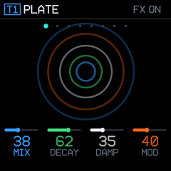 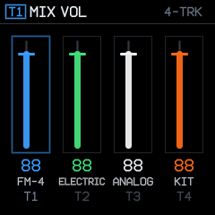 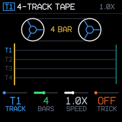
</p>

A page's four columns are the four knobs. SELECT steps through its subpages.

| Page | Button | Columns |
|---|---|---|
| FX | FX | The effect's four knobs |
| MIX | SEL | Track volume, pan, FX send (one column a track); master LOW, MID, HIGH, DRIVE; KEY: OFF or ON per track (DRUM on a drum track) |
| ENV | ENV | ATTACK, DECAY, SUSTAIN, RELEASE; the mod envelope's DEPTH, DECAY, VEL, PUNCH |
| LFO | LFO | SHAPE, RATE, DEPTH, TO (pitch, a knob, level or pan) |
| GLOBAL | GLO | TEMPO, SWING, TUNE, BRIGHT; KEYS: ROOT, SCALE, GLIDE, HOLD |
| CHORDS | hold ARP | PADS: MODE, SET (in SCALE and SHAPE: TYPE); PLAY: VOICING, STRUM |
| SEQ | ARP | MODE (OFF, RIFF, SHAKE, UP, DOWN, UP/DOWN, RANDOM, CHORD), RATE, RANGE, GATE. In SHAKE: MODE, GRAV, SPIN, BOUNCE; MODE, CAGE |
| TAPE | SEQ | TRACK (T1 to T4), BARS (1 to 32), SPEED (0.5X, 1X, 2X, REV), TRICK (BRAKE, stutters); edit: IN BAR, OUT BAR, SNAP, PITCH; LANE: BAR, ROOT, SCALE, DEG |

## The tape

Four tracks, T1 to T4, each with its own engine, algorithm, knobs, volume, pan, send and mute. The tape is 1 to 32
bars and holds 2,048 events (1,024 notes) across the four tracks, knob moves included; when it is full the screen
says **TAPE FULL**. The tape and every setting save themselves and come back after a restart.

- **REC** arms the track in hand and the first key starts the take. REC again closes it and the tape plays on. REC
  while it plays overdubs. Knobs turned while recording play back as automation.
- **PLAY** starts and stops the tape. SPEED plays it at half or double speed or backwards; TRICK adds a brake or
  stutters.
- **EDIT + REC** cuts the track in hand's notes between the in and out bars to a clipboard; **EDIT + PLAY** pastes
  them at the current bar. **EDIT + OCT −** and **EDIT + OCT +** move the in and out bars.
- **Hold REC** clears the track in hand. Keep holding (about three seconds) for CLEAR ALL?, then tap REC within three
  seconds of letting go to clear the whole tape. Anything else keeps it.

**KEY.** A track can play its tape in the key set now. On MIX (SEL), SELECT four times to KEY and turn a track's knob
to ON. Its notes then follow GLO's ROOT and SCALE from the key they were recorded in: ROOT up 2 plays the track two
semitones up. Between two seven-note scales (MAJOR, MINOR, DORIAN) a note keeps its scale step; otherwise it moves
with ROOT and snaps to the new scale. CHROM moves it with ROOT only. Drum engines (KIT, SKINS) never move and say
DRUM. Tapes from 0.6.0 and earlier, and tracks with KEY off, play as recorded. MIDI out sends notes as they sound.

**LANE.** The key can change bar by bar. On the tape page, SELECT twice to LANE: BAR (K1) picks a bar, and ROOT (K2),
SCALE (K3) and DEG (K4) set its entry. Turn a field below its first value for "-" (the screen reader says NONE).
DEG is the chord degree: IV in C major plays F, A, C where the tape has C, E, G. Each field holds until a later entry
sets it: bar 1 SCALE MINOR and bar 3 ROOT D play D minor from bar 3. Unset fields come from GLO's ROOT and SCALE, and
DEG I. Only KEY tracks follow the lane, a change starts on its bar's first tick, and sounding notes keep their pitch.
While the tape plays, the header names the key in force (for example D MAJ . IV), and the live keys and chord
memory's SCALE mode snap to its root and scale. STEP ignores the lane.

The lane belongs to the whole tape: CUT, PASTE and holding REC leave it, CLEAR ALL clears it. A note recorded over a
DEG bar on a KEY track is stored moved back down, so it plays as played and follows later changes. A tape with a lane
loads on 0.6.0 without the lane or its punches.

**STEP.** Hold SEQ to swap the tape for the step sequencer. REC turns step writing on and off, PLAY runs the pattern,
SELECT moves the cursor and a tap of EDIT leaves a rest. The pattern takes the ROOT and SCALE in force when its first
step is written, and a KEY track plays it in the key set now, as it does the tape.

## Projects

The FM-1 keeps four projects beside what plays. A project is the tape and every setting, the eight snapshots
included, except TUNE and BRIGHT, which stay with the unit. The keys are the first four black keys from the lowest F:
F#, G#, A# and C# for projects 1 to 4.

- **SAVE + EDIT + the key** saves what plays to that project: **SAVING P2**, then **P2 SAVED**. It works while the tape
  plays, but not while a take goes in (**RECORDING**).
- **SAVE + the key** loads it, with the tape stopped (**STOP TAPE FIRST** otherwise, **REC ARMED** while REC waits for
  its first key). If what plays has changed since
  it was last saved to a project or loaded from one, the screen asks **LOAD P2? AGAIN**: the same keys within three
  seconds load it, and anything else keeps your work. The sound stops for the load (CC 123 goes out), and from then on
  the project's tape and settings are what plays, saving themselves as always.
- With **SAVE** held, the black keys that hold a project light up.

**Back them up.** The projects live in the part of the FM-1's flash that firmwares share, so one installed after A22
may write over them. Keep them on a computer before you switch: the [companion page](https://abektes.github.io/a22/companion/)
(Chrome or Edge, the FM-1 on USB, the tape stopped) lists `project1.a22` to `project4.a22`. **Back up all** saves them in one
zip, and **Restore from a backup** puts them back. From a terminal in a clone:
`python3 base/tools/fm1_companion.py get project1.a22` and
`python3 base/tools/fm1_companion.py put project1.a22 project3.a22`.
A project file put back under any number becomes that project.

## Riff and Shake

Modes of the SEQ page (ARP, then ALGORITHM; or hold EDIT and turn ALGORITHM anywhere).

- **RIFF:** on the SEQ page, REC starts recording. Play notes one at a time, tap EDIT for a rest, and REC to finish.
  Hold any key and the riff plays from it, transposed. Hold REC on the page to clear it.
- **SHAKE:** every key drops a ball into a spinning cage, and the ball plays its note each time it bounces. GRAV,
  SPIN and BOUNCE are on the page, CAGE on its second subpage. KNOB 1 stays MODE.

## Chords

**Hold ARP** to open CHORDS. SELECT steps between PADS and PLAY.

- **MODE:** OFF; PADS, a chord on each of eight keys; MEMORY, a chord you play in; SCALE, chords from the KEYS page's
  root and scale (with CHROM, the major scale); SHAPE, a fixed chord.
- **PLAY** subpage: **VOICING:** CLOSE; OPEN (the middle note up an octave); DROP2 (the second from the top down an
  octave); +BASS (the root again an octave below); SMOOTH (the inversion closest to the last chord). **STRUM:** 0
  plays the notes together; up to 60 ms between them, bottom up. The screen shows the last chord on a keyboard.

**PADS.** The eight white keys from the lowest F play eight chords; the other keys play notes. K2 picks the **SET**:
POP, BALLAD, SOUL, LOFI, JAZZ, CINEMA, HOUSE and DARK, three of each. The screen shows each pad's chord and its
numeral (a minor one underlined; BORROWED for a chord whose root is outside the set's major or minor key). The chords
are built from the KEYS page's ROOT, or the lane's while the tape plays; SCALE doesn't change them, and still snaps
the other keys. OCT moves chords and notes together. On KIT and SKINS the keys stay drums. MONO plays a pad's root.

**TYPE** (SCALE and SHAPE): in SCALE, TRIAD, 7TH, SUS2, SUS4, ADD9 or 6TH. In SHAPE, MAJ, MIN, SUS4, 7, MIN7, MAJ7,
POWER or OCT.

**Hold the keys and press EDIT + GLO** to store them as MEMORY's chord (up to six notes); each key then plays that
shape from itself. Pad keys don't count. EDIT + GLO with no keys held turns chords off and on.

The tape, the step sequencer, the arpeggiator and MIDI out get the chord's notes, so recordings play back as heard.
MIDI in is never made into chords. MONO plays the root alone. A chord takes a voice per note, out of eight.

## Hotkeys

| Control | What it does |
|---|---|
| PRESETS | Engine. **Hold EDIT:** the track in hand, T1 to T4 |
| ALGORITHM | The engine's algorithm. On the FX page: the effect. On the SEQ page, or with EDIT held: the sequencer mode |
| KNOB 1–4 | Home: the engine's four knobs. On a page: its columns. On the MIX volume subpage with EDIT held: mute T1 to T4 |
| SELECT | Home: tempo. On a page: the next subpage. Writing steps: the cursor. **Hold EDIT:** the track's volume |
| MASTER | Volume of everything. **Hold EDIT:** the track's volume |
| FX SEL ENV LFO GLO ARP SEQ | Open that page; HOME goes back. FX opens its page on release unless a punch was played |
| hold FX + white key 1–8 | A punch on the whole mix (see Effects). Hold EDIT first, then FX, for the bypass |
| EDIT | Pins the knob strip on the home screen. Writing steps or Riff: a rest |
| EDIT + FX | Effect on or bypassed |
| EDIT + SEL | Mute the track in hand |
| EDIT + ARP | Hold (latch) on and off |
| EDIT + GLO | With keys held (pad keys aside): store them as the chord. With none: chords off, or on again |
| EDIT + LFO | DICE: roll the four knobs of the algorithm in hand, near where that algorithm sits |
| EDIT + ENV | Back to the knobs before the last roll, and again to the roll |
| SAVE | Save the settings now |
| SAVE + white key 1–8 | Load that snapshot, or save to it if empty. **SAVE + EDIT + key** saves over it |
| SAVE + F#, G#, A#, C# | Load project 1 to 4 (the tape stopped). **SAVE + EDIT + key** saves to it (see Projects) |
| hold SAVE | Reset the algorithm's knobs. About two seconds: the engine. Four: every engine and the GLOBAL and KEYS pages |
| hold SEQ | Swap TAPE and STEP |
| hold ARP | CHORDS (see Chords) |
| hold GLO | Metronome: CLICK REC, CLICK ON, CLICK OFF |
| hold HOME | Silence everything (and send CC 123) |
| OCT − / + | Octave, two each way. Both together: the middle octave |
| hold OCT − and OCT + | USB host for a keyboard, or back to the computer |

A button with a hold does its tap when it is let go.

## USB audio and MIDI

Over a USB cable that carries data, the FM-1 shows up as one device with an audio input (like a USB microphone; nothing
plays back through it) and MIDI.

**Audio,** ten channels at 44.1 kHz. Pick the `A22 FM-1` input in a DAW, a recording app or the system's sound settings:

| Channels | What's on them |
|---|---|
| 1-2 | The whole mix at the MASTER volume, the same as the speaker |
| 3-4, 5-6, 7-8, 9-10 | T1, T2, T3 and T4: each track at its volume and pan, and MASTER |

The tracks are dry: the effect, the master bus (EQ and drive), TRICK, the punches and the metronome run over the whole
mix, so they are on 1-2 only. Notes played by hand are on the track in hand's pair, and a muted track's pair is silent.
A recording app that wants stereo takes 1-2. To split a ten-channel file into five stereo ones, run
`python3 tools/a22_stems.py REC.wav --split OUTDIR`.

**MIDI in,** over USB or the TRS jack, any channel: notes play the engine in hand at their velocity (softer is
quieter and darker), CC 20 to 23 turn the four knobs, and CC 123 stops every note.

**MIDI out,** over USB only, a channel per track (T1 on 1 to T4 on 4), so a DAW records the tracks apart:
- tape and step notes on their track's channel; the keys, chords and arpeggiator on the track in hand's;
- CC 20 to 23 as the knobs turn, live or from the tape;
- MIDI clock at TEMPO all the time, with Start when the tape or step pattern starts and Stop when it stops (and Stop
  then Start when the tape jumps back to IN);
- CC 123 on channels 1 to 4 when HOME is held.

Notes that came in over MIDI aren't sent back. A synth on A22's MIDI out hears T2 to T4 only in omni mode.

**A USB keyboard, with no computer.** Hold **OCT −** and **OCT +** for a second and the port becomes a USB-MIDI host.
The keyboard needs its own power or a powered hub, and gets no clock. Hold both again to go back; the FM-1 always
starts as a USB device.

## Install

Releases are on [GitHub](https://github.com/abektes/a22/releases), and [The Firmware Hub](https://thefirmwarehub.com)
offers each one a few hours after it is out.

**Before you install:**
- **Back up first.** Each firmware keeps its work in the FM-1's flash its own way; save what the firmware you are
  leaving made with its own backup ([the Hub's notes](https://thefirmwarehub.com/kb/#data)).
- Charge the FM-1 and use a USB cable that carries data.
- A22 is community firmware with no warranty and nothing to do with M-VAVE. You install it at your own risk.

**The package.** Download `a22-X.Y.Z.fwsc` from the [latest release](https://github.com/abektes/a22/releases/latest);
release X.Y.Z answers `FM-1_4122XXYYZZ`. Every push to `main` also builds a development package: the `a22-dev-build`
artifact of the latest successful **Actions** run holds `a22.fwsc` (identity `FM-1_412200`), and `a22-release-test`
is the next release as it will be built.

**From a terminal,** in a clone of this repo (`git clone --recurse-submodules`), with the FM-1 on USB:

```
pip3 install mido python-rtmidi
python3 base/tools/fm1_install.py a22.fwsc
```

It works from the stock firmware (V15) and other custom firmwares, asks before it writes, and checks what the FM-1
answers afterwards. Update anything older than V15 with M-VAVE's updater first.

## Leave A22 again

A22's package carries fm1-base's update loader, so other installers can replace it: use another firmware's own
installer or its card on [The Firmware Hub](https://thefirmwarehub.com), or press **Back to official V15** in the
Hub's [Official firmware](https://thefirmwarehub.com/#official) box. A22 saves only its own settings, so leaving it
doesn't bring back what an earlier firmware saved. Back up your projects first (see [Projects](#projects)): another
firmware may write over them.

## If something goes wrong

From fm1-base, which A22 is built on:

- **An install stopped halfway:** plug the FM-1 back in and install again; the loader picks up where it stopped.
- **A22 doesn't start:** after two failed starts it comes up in SAFE MODE, with no sound but working USB, so A22,
  another firmware or V15 can be installed.
- **Nothing reaches it:** hold **REC** while switching it on. That is the chip's own update mode, and the Hub's
  [rescue page](https://thefirmwarehub.com/tools/rescue/) takes it from there. The bootloader is in ROM and can't be
  overwritten.

## Compatibility

- **M-VAVE FM-1 only,** not the SMK-37.
- **Both flash chips:** the original Puya P25Q80 (JEDEC `0x856014`) and the UC25HQ80 (`0xB36014`). Since 0.7.2 the
  panel gets its full setup, which the newer units need; reports from them are welcome.
- USB audio out (the mix and the four tracks), USB MIDI in and out, or USB host for a keyboard; MIDI in over the TRS jack. No MIDI out over TRS and
  no Bluetooth.
- A screen reader ([fm1-reader](https://github.com/charlesvestal/fm1-reader)) hears the engine, algorithm, page and
  each control's value as it changes.
- The image is about 563 KB of the 582 KB flash slot; it uses about 466 KB of the chip's 475 KB of SRAM.

## For developers

```
core/    the whole firmware: portable C99, no libc, no malloc
app/     the device: fm1-base's app, a thin pass-through to core/
base/    fm1-base (a git submodule, with felucca-bsp inside it)
port/    other builds of the same core: host (pictures, WAVs), rfm1 (browser simulators)
tests/   the device app in fm1-base's host simulator, the core alone, and the crash hunt
```

- `./build.sh` builds `app/build/a22.fwsc` (identity `FM-1_412200`) with JieLi's toolchain and the AC79 SDK (see
  `base/README.md`); `./build.sh --release X.Y.Z` builds a release.
- `sh tests/run_tests.sh` runs the device app in fm1-base's host simulator, then the core's tests, most under the
  address and undefined-behaviour checkers; its header says what each one holds. It needs a C compiler and Python
  with Pillow, numpy and scipy.
- `sh tests/run_fuzz.sh` is the crash hunt: any saved state and any panel input, under the same checkers.
- The second core renders half the voices; `FM1B_CPU2=0 ./build.sh` builds without it (see
  [docs/ARCHITECTURE.md](docs/ARCHITECTURE.md)).
- `tools/build_host.sh` builds `build/h1host`, a script runner that writes pictures and WAVs. `tools/build_rfm1.sh`
  builds `dist/a22.rfm1` for `.rfm1` hosts such as
  [fm1-browser-simulator](https://github.com/jakehandy/fm1-browser-simulator).
- `tools/fm1_profile.py` times the audio on an FM-1 over USB, per algorithm or in a loop jam.
- CI runs the tests and builds the firmware on every pull request and push to `main`. A tag `vX.Y.Z` runs
  `.github/workflows/release.yml`, which builds, tests, attests and publishes the release through the shared
  [fm1-build](https://github.com/zvenson/fm1-build) builder.
- `firmware.json` is written by the build from `app/fm1.toml`.

[docs/README.md](docs/README.md) lists the rest of the docs: how A22 is built, the release checklist, and the
plans and measurements behind each release.

## On a computer

A22's synth core also runs without the FM-1 in [a22-soundtrack](https://github.com/abektes/a22-soundtrack), an agent
skill that scores videos offline with A22's engines and frame-timed sound effects
([demos](https://abektes.github.io/a22-soundtrack/)).

## Support

A22 is free and stays free. If it gave you a good evening, you can [buy me a coffee](https://buymeacoffee.com/abektes).

## Licence

A22 is [MIT](LICENSE), as h1 is.

The firmware package also contains [fm1-base](https://github.com/charlesvestal/fm1-base) by Charles Vestal and
[felucca-bsp](https://github.com/hugelton/felucca-bsp), from [Felucca](https://github.com/hugelton/Felucca) by Leo
Kuroshita, Hügelton Instruments. Both are MPL-2.0, unchanged; their source is the `base` submodule at the commit a
release was built from, and their notices are in `base/LICENSING.md` and `base/bsp/NOTICE`.

CYCLE's wavetables are made from [Adventure Kid Waveforms](https://github.com/KristofferKarlAxelEkstrand/AKWF-FREE) by
Kristoffer Ekstrand, CC0 1.0 ([docs/WAVETABLES.md](docs/WAVETABLES.md)).

M-VAVE and FM-1 are trademarks of their owners. A22 is not affiliated with M-VAVE.
