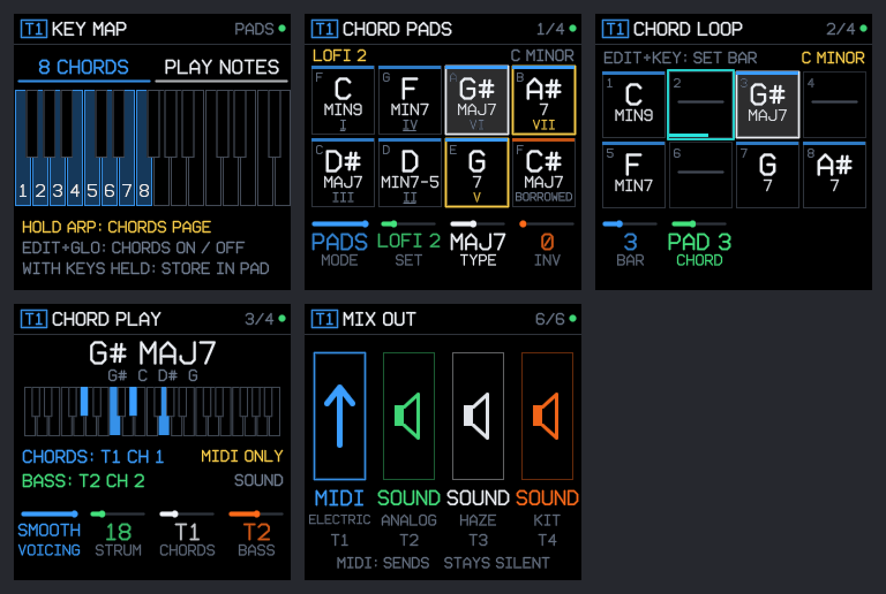
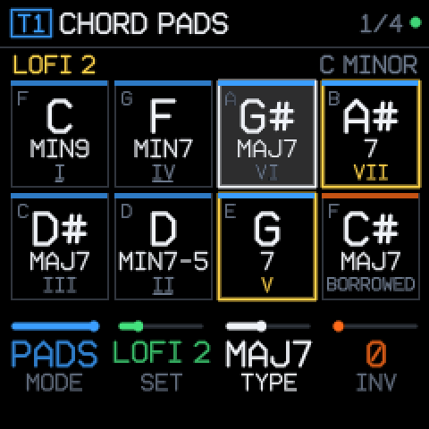
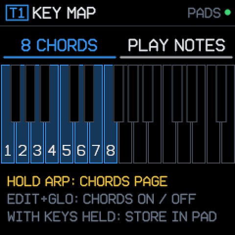
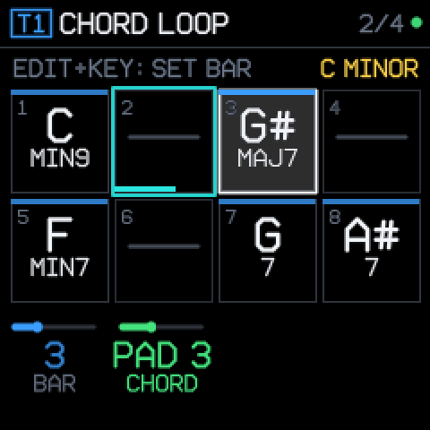
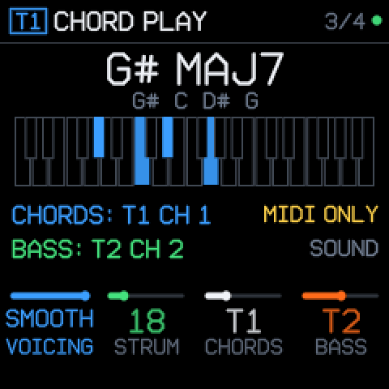
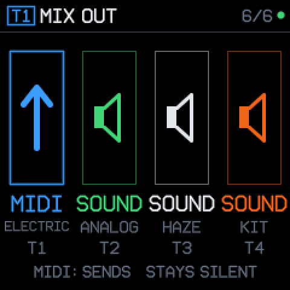

# Chord pads and a chord loop, for playing a DAW from the FM-1

Design, 2026-11-27. **Approved 2026-11-27.** The sprints are in [PLAN-chords.md](../../PLAN-chords.md).
Code references are to `a22/main` at `8bb887a`.

The pictures are mock-ups, drawn with A22's own `core/gfx.c` and palette at the FM-1's 240 × 240. They are not
firmware. The key map is a diagram, not a screen. The screens show the finished feature: TYPE and INV arrive in sprint
2, where chords and bass go (CHORD PLAY) and MIX OUT in sprint 3, and the gold suggestion boxes in sprint 4.

## Why

The owner plays chord ideas in Scaler on an iPad: a set of eight chords, variations of each, a row of chord slots,
suggestions, keys lock and voicing lock. They want that on the FM-1, "with similar ux", with chord progressions and
sequencing that drive a DAW over USB, and controls that are more straightforward.

A22 already has part of it. Chord memory plays a chord from one key (MEMORY, SCALE, SHAPE). The tape lane changes ROOT,
SCALE and DEG bar by bar. Tape and step notes go out over USB on a channel per track, with MIDI clock, Start and Stop.
What's missing is a different chord on each key, ready-made sets, chord names on the screen, smooth voicing, a
progression that plays by itself, and a track that drives the DAW without sounding. The chord settings are also three
steps deep, in GLO's third subpage.

## Goals

- **Eight chords under eight keys,** named on screen, from a set picked by one knob, in the key set now.
- **One place for chords:** a CHORDS page, one gesture away, laid out as the keys are.
- **A progression that plays by itself** in time with the tape, with chords and bass on their own MIDI channels.
- **A track can send without sounding,** so the DAW's instrument is the only one heard.
- **Similar to Scaler where the FM-1 allows:** pads, variations, a chord timeline, suggestions, keys lock, voicing
  lock, humanize.

## Non-goals

- The DAW driving A22: no clock in and no following the DAW's PLAY (as decided for 0.7.0's MIDI out). The FM-1 sets
  the tempo.
- Scaler's own chord sets, or artist and song names. A22 gets sets of its own, by mood or genre.
- More scales. A recorded note's key byte holds the scale in three bits, so the eight scales A22 has are all that fit.
  More scales would change the tape's format: a separate design.
- MIDI in turned into chords, detecting chords or scales from audio or MIDI, a `.mid` export, MIDI out on the TRS jack
  (it is an input).
- An arranger beyond the tape's 32 bars.

## Anti-goals

- **A note left sounding,** on the FM-1 or in the DAW, when a pad, set, key, mode, track or transport changes while it
  plays. A note's off goes where its on went.
- **A second chord timeline.** The progression is the tape lane's, not a new set of patterns beside it.
- **Two homes for one setting.** ROOT and SCALE stay on GLO KEYS, BARS stays on TAPE, VOICING and STRUM move to CHORDS.
- **Hidden controls.** Two new gestures in all, each hinted on screen.
- **Losing what a player made:** a set change over edited pads asks first. Settings and tapes saved by 0.1.0 to 0.7.x
  load as before.
- **Audio overload:** eight voices as now; no late audio in the measured jams.

## Constraints

From CI's build of the projects branch ([abektes/a22#23](https://github.com/abektes/a22/pull/23), head `d4c7016`, open
on 2026-11-27):

| | Used | Free |
|---|---|---|
| Flash (app slot 581,564 B) | 563,856 B | **17,708 B** |
| SRAM (475,136 B) | 465,800 B | 9,336 B, of which 8,192 kept spare: **1,144 B** |
| Audio on 0.7.2, eight-note chords, 112 algorithms, PLATE | average 49.5%, peak 73% | |
| Audio on 0.7.2, four-layer loop jam | peak 75%, 21 to 25 frames a second | |

- `core/` is portable C99 with no libc and no malloc.
- The screen font has capitals only, and A22 names notes with sharps. So chords read `G# MAJ7`, a minor numeral is
  underlined (as on the lane), and a chord whose root is outside the key says BORROWED in place of a numeral.
- Eight voices. A chord and a bass note take five.
- A chord has at most six notes (`CHORD_MAX`).
- A22 reads no velocity from the FM-1's keys.
- Every page, column and new word is named for the screen reader (`app/words.tsv`).

## Controls

### The two new gestures

| Gesture | Does | Why this one |
|---|---|---|
| **Hold ARP** | Opens CHORDS from anywhere | ARP has no hold today. Its tap moves to release, as GLO's and SEQ's already do. ARP's own page (SEQ) says HOLD ARP: CHORDS |
| **EDIT + a chord key,** on CHORD LOOP | Puts that pad on the bar in hand and moves to the next bar | Writes a progression by playing it; the page says so. The knobs do the same without it |

### What stays, what changes

| Control | Today | With this design |
|---|---|---|
| EDIT + GLO, no keys held | Chords off, or on again | The same: the only on/off gesture |
| EDIT + GLO, two or more keys held | Store them as MEMORY's chord | The same; with MODE PADS, stores the keys held beside the pads in the pad last played |
| GLO subpages | GLOBAL, KEYS, CHORD | GLOBAL, KEYS. CHORD moves to the CHORDS page |
| Keys, MODE PADS | | The eight white keys from the lowest F play pads 1 to 8; every other key plays notes as now |
| OCT − / + | Moves the keys | Moves notes and chords alike; the pads stay on the same keys |
| SAVE + white key | Snapshots | The same, and it wins over pads |
| FX held + white key | Punches | The same, and it wins over pads |
| EDIT + ARP (HOLD) | Latches notes | Latches pads too |
| MIX subpages | VOL, PAN, FX SEND, MASTER, KEY | A sixth, OUT: SOUND or MIDI per track |
| PLAY, tape BARS, TEMPO, loop IN and OUT | The tape's | The chord loop uses them; nothing new to set |

### The CHORDS page

SELECT steps through the subpages. HOME leaves. The ARP button blinks while the page is open.

| Subpage | K1 | K2 | K3 | K4 | Sprint |
|---|---|---|---|---|---|
| 1 PADS | MODE: OFF, PADS, MEMORY, SCALE, SHAPE | SET in PADS; TYPE in SCALE and SHAPE | TYPE of the pad in hand | INV of the pad in hand | 1 (TYPE and INV: 2) |
| 2 LOOP | BAR | CHORD: -, PAD 1 to 8, REST | | | 3 |
| 3 PLAY | VOICING: CLOSE, OPEN, DROP2, +BASS, SMOOTH | STRUM | CHORDS: OFF, T1 to T4 | BASS: OFF, T1 to T4 | 1 (K3 and K4: 3) |
| 4 FEEL | STYLE: BLOCK, PULSE, UP, OFFBEAT | HUMAN: 0 to 100 | SUGGEST: OFF, ON | | 4 |

K3 and K4 of PADS are empty outside MODE PADS.

## How it behaves

### Pads

 

- **A pad** is a root, counted in semitones above KEYS ROOT, and a chord type. Turning ROOT moves all eight.
- **A set** is eight pads and a name. 24 sets ship, three each of eight moods (for example POP, BALLAD, LOFI, SOUL,
  JAZZ, CINEMA, HOUSE, DARK). A set is written for a major or a minor key and does not change SCALE; the header names
  the key as it is set.
- **The pad in hand** is the last one played. TYPE and INV edit it. The screen outlines it.
- **Edited pads** belong to the saved settings, so a project carries them. Turning SET over edited pads asks
  `NEW SET? TURN AGAIN`, as CLEAR ALL asks.
- **Voicing** applies to pads as to chord memory. **SMOOTH** picks the inversion and octave closest to the last chord
  played.
- **Keys lock** is KEYS SCALE, as today: it snaps the notes played beside the pads. Pads are picked by their key, never
  snapped.
- **The notes** go where chord memory's go: the tape, STEP, the arpeggiator, latch and MIDI out all receive them.
- **Mono engines** play the root alone, as chord memory does. A MIDI-only track (below) sends the whole chord whatever
  its engine.
- **Drum tracks** (KIT, SKINS): pads are off and the keys play drums. Playing one says `NOT ON DRUMS`.
- **MIDI in** is never made into chords.
- **A recorded pad chord on a KEY track** follows ROOT, SCALE and DEG as any recorded notes do. A borrowed note can
  move to the nearest note of a new scale; this is KEY's rule today.

### The chord loop

- **It is the tape lane.** Each bar's lane entry gets one more field, CHORD: a pad, REST, or nothing (the chord before
  holds). CHORD LOOP edits that field; TAPE LANE goes on editing ROOT, SCALE and DEG. One timeline, two views, split
  by what is being changed.
- **PLAY, STOP, TEMPO, BARS, IN, OUT and SPEED** are the tape's, so MIDI clock, Start and Stop work unchanged.
- **A bar with a CHORD plays it** at its first tick, and holds it until the next bar that has one. Bars before the
  first are silent.
- **Chords go to one track and bass to another** (PLAY subpage; T1 and T2 at first), with that track's engine and its
  MIDI channel. Bass is the pad's root, an octave below. A drum track set to either sends the notes over MIDI and
  stays silent.
- **The lane's ROOT** moves the loop's chords.
- **A CHORD also gives the bar its degree,** so KEY tracks follow the progression without it being entered twice. A
  pad rooted on a note of the scale sets that degree. A DEG entered on the same bar wins over it. A borrowed chord
  or a REST leaves the degree as it was. DEG never moves the loop's own chords. A track with KEY off plays as
  recorded.
- **The loop's notes are not recorded** onto the tape. What is played over it records as now.
- **STEP mode** ignores the loop, as it ignores the lane.
- **CLEAR ALL** clears it with the lane. Holding REC (one track) does not.
- **Older firmware** loads the tape and drops the CHORD fields.

### Where the sound goes

 

- **MIDI** (MIX, OUT) makes a track send its notes and make no sound and take no voices. It covers the tape, STEP, the
  keys, the arpeggiator and the chord loop. Mute still stops both.
- **A silent track says why.** With a MIDI track in hand, HOME's top bar says MIDI in gold where the tempo is. A key
  pressed on it with no computer listening says `MIDI ONLY: NO USB`.

### Suggestions and feel (sprint 4)

- **SUGGEST** blinks the keys of up to three pads that follow the last one well, and outlines them in gold. The ranking
  comes from the distance between roots (a fifth down first), from a small table.
- **HUMAN** delays each note of a loop or pad chord by a little and lowers its velocity by a little, more as it is
  turned up.
- **STYLE** is how the loop plays its chord: held, pulsed in eighths, rolled upward, or off the beat.

## Approaches

**Where it lives.**
- **Picked: inside A22.** The chord code sits where chord memory is, costs little audio time and reuses MIDI out.
- A fork: gains room only by removing engines or effects, and doubles releases and testing on one FM-1.

**What the progression is.**
- **Picked: a CHORD field in the tape lane.** One timeline, saved with the tape and in projects, with the tape's
  transport, length and MIDI clock.
- Four patterns of eight slots, as Scaler has: closer to the iPad, but a second timeline beside the lane, with its own
  transport, length and storage. Projects give four songs instead.
- The step sequencer: its notes last one step, so a chord can't hold a bar.

**Where edited pads are saved.**
- **Picked: the saved settings, version 6,** with a version 5 state loading as before. One version change for every
  sprint: sprint 2 reserves the bytes sprints 3 and 4 use.
- The tape: no version change, but settings stored as tape events would make an empty tape look recorded.

**Order.**
- **Picked: pads, then editing them, then the loop, then feel.** Each can ship alone, and the loop plays the pads.
- The loop first: the sequencing arrives sooner, but on chords that can't be played or edited yet.

## Budget

Estimates, to be replaced by each sprint's CI build.

| Sprint | Flash | SRAM |
|---|---|---|
| 1 pads | 5 KB | 80 B |
| 2 your own chords | 2 KB | 80 B |
| 3 chord loop | 5 KB | 160 B |
| 4 feel and suggestions | 3 KB | 40 B |
| **Total** | **15 KB of 17.3 KB** | **360 B of 1,144 B** |

That leaves about 2 KB of flash, too little to fix things with. The plan has a gate before sprint 3: keep the slot and
cut scope, or grow the app slot (fm1-base `app_end`, no higher than 0xAF000, where projects start). A bigger slot
changes what an install erases and has to be tried on the FM-1 first.

## Calls made here, to check

1. A chord on a bar moves KEY tracks to that chord's degree, unless the bar has its own DEG. A melody on a KEY track
   therefore shifts with the progression; turn its KEY off to keep it as recorded.
2. The progression is the lane's, up to 32 bars, instead of Scaler's four patterns.
3. Hold ARP opens CHORDS; GLO loses its CHORD subpage.
4. The FM-1 stays the clock; the DAW follows.
5. 24 sets, three each of eight moods. The names and chords are placeholders until judged by ear.
6. Pads are off on drum tracks.
7. A set change over edited pads asks before it replaces them.
8. Pads, editing, loop, feel: that order. (You asked for sprints without picking pads or loop first.)

## Left to the builder

- EDIT used with a chord key must not also toggle the knob strip when it is let go, or show the volume ring.
- The byte for the chosen set (`H1State.rsv[1]`, which nothing reads today and loading zeroes: sprint 1 keeps it
  instead). MODE PADS is a new value of `st.chord[0]`; SMOOTH a new value of `st.chord[2]`. Older firmware reads both as
  its defaults.
- Which chord slot and latch a pad uses. Chord memory finds a slot by its root note (`chs[]`) and latches by note
  number (`latched[]`), so two pads on one root, or a pad and a played key at the same pitch, would collide.
- The CHORD field in a lane entry (`LEv.part`: the loader zeroes it for lane entries today, and no other reader of
  it reaches them). The lane's degrees are rebuilt when a pad or ROOT changes. An entry with only a CHORD must survive `eng_loop_load` and `lane_set`, which both drop an entry whose ROOT, SCALE and DEG are all none.
- A tape that holds only lane entries: that it has a length, plays from PLAY, saves and loads. Check this first in
  sprint 3.
- MIDI only as a four-bit mask in version 6's reserved bytes. (`Track.rsv` won't do: MIX's KEY knob writes that whole
  byte.)
- How the core learns whether a computer is listening on MIDI out.
- How a pad's notes are stored for TYPE edits and captured chords, and how a captured chord is named.
